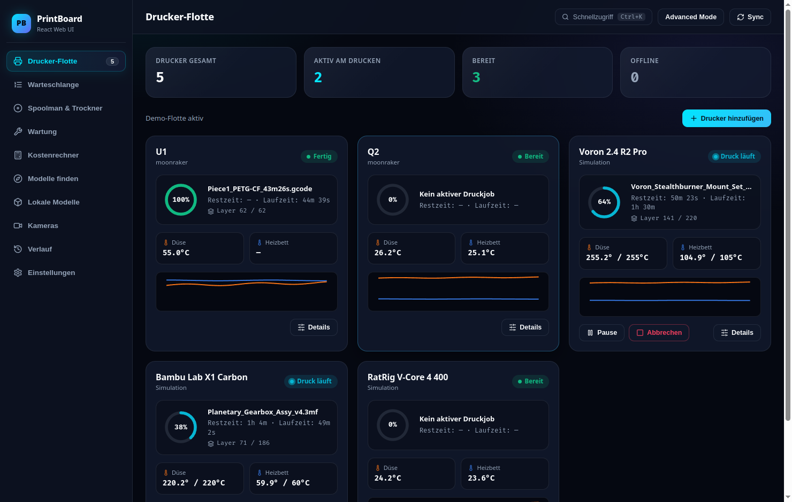
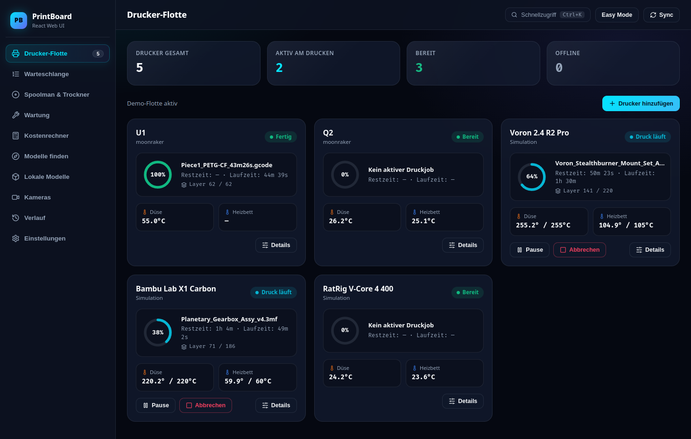
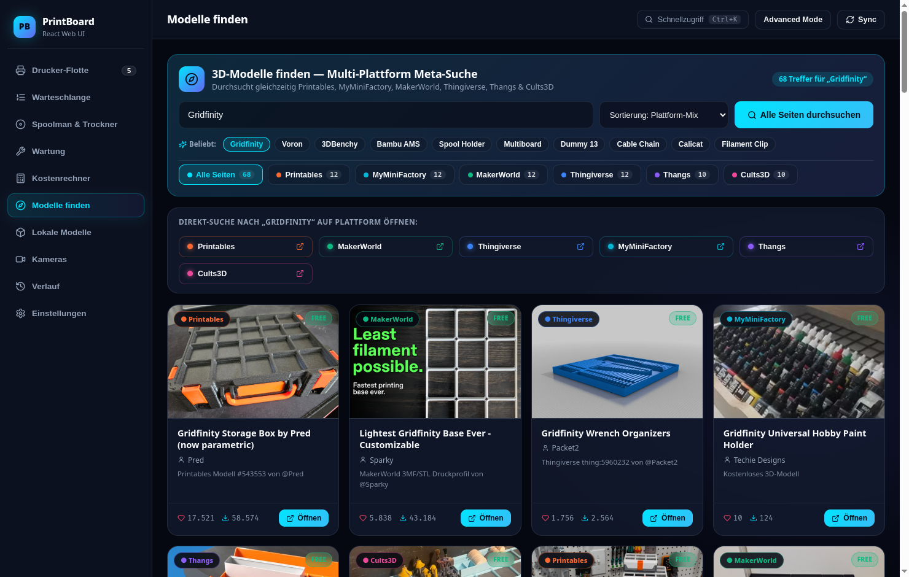
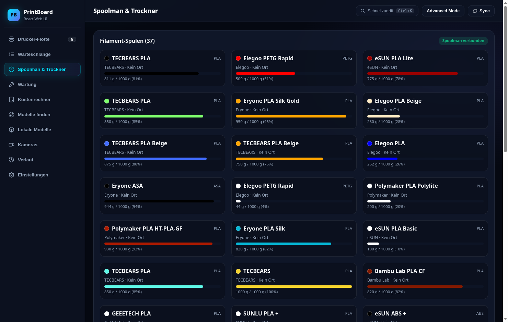
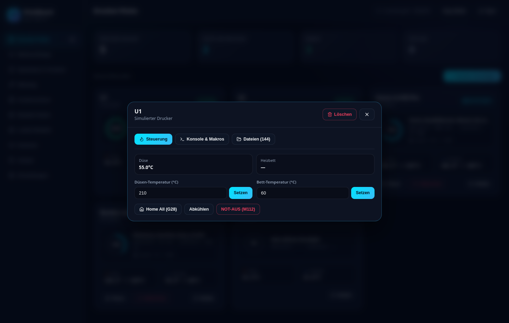
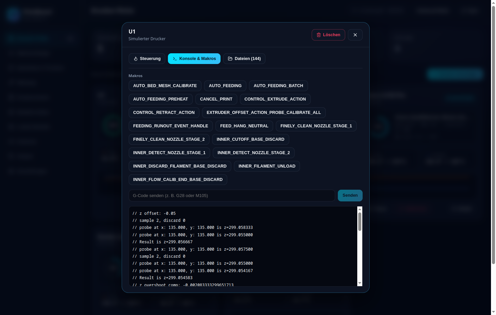
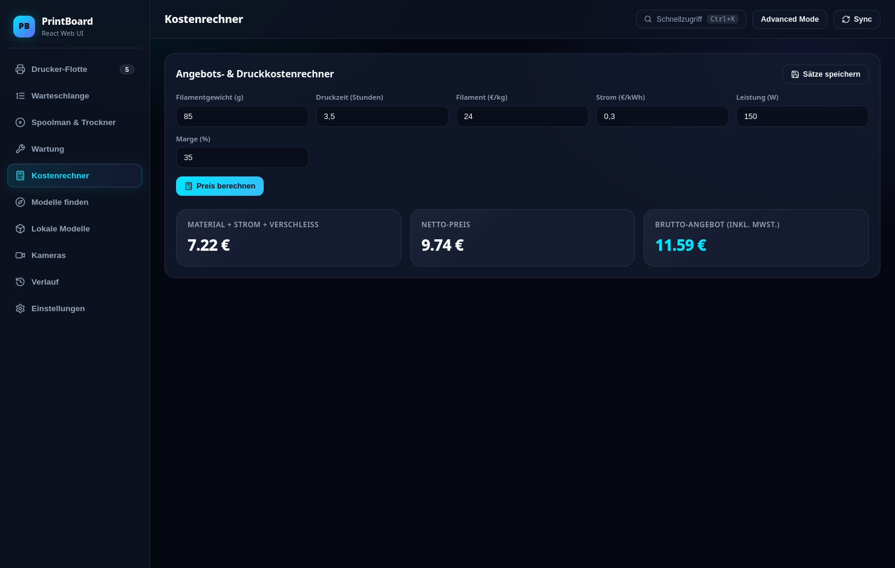
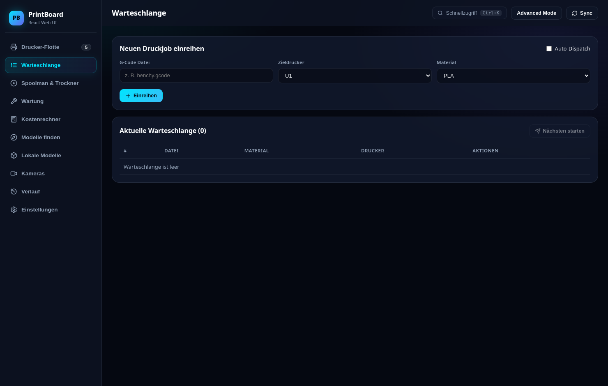
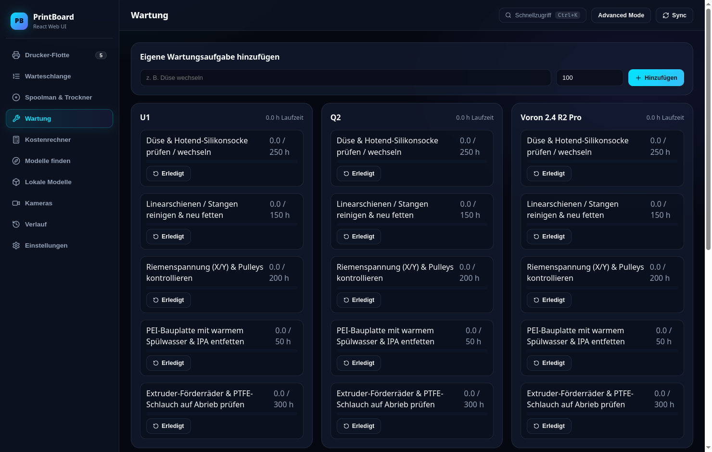

# PrintBoard Studio 1.0

**Die moderne WebUI & Kommandozentrale für Klipper / Moonraker (Fluidd / Mainsail), Bambu Lab & Spoolman 3D-Drucker-Flotten.**

PrintBoard Studio vereint Echtzeit-Telemetrie, Direktsteuerung, **Easy Mode & Advanced Pro Mode**, Spoolman-Filamentverwaltung inkl. Trockner-Timer, eine **Multi-Plattform 3D-Modell Meta-Suche** (*Printables, MakerWorld, Thingiverse, MyMiniFactory, Thangs & Cults3D*), eine Auto-Dispatch-Warteschlange, Wartungs-Tracking und einen **Angebots- & Verkaufspreis-Kalkulator** in einer reaktiven WebUI.



---

## ✨ Highlights & Features

- **⚡ Easy Mode & Advanced Pro Mode**: Wechsel jederzeit mit einem Klick in der Topbar zwischen dem kompakten *Easy Mode* und dem *Advanced Pro Mode* mit Live-Temperaturkurven für Düse und Heizbett.
- **🖨️ Klipper / Moonraker & Bambu Lab Support**: Einheitliche Überwachung und Steuerung gemischter Drucker-Flotten (Temperaturen, Fortschritts-Ringe, Layer-Anzeige, Restzeit, Pause/Weiter/Abbrechen, Not-Aus `M112`).
- **🧭 3D-Modelle finden (Multi-Plattform Meta-Suche)**: Durchsucht gleichzeitig **Printables**, **MakerWorld**, **Thingiverse**, **MyMiniFactory**, **Thangs** und **Cults3D** und listet klickbare Ergebnis-Karten mit Vorschaubildern, Likes, Downloads, Plattform-Filtern und Direkt-Links auf.
- **🎯 Spoolman & Filament-Trockner**: Live-Spulenbestand mit Farbbalken, Restgewicht-Anzeige in Gramm & Prozent sowie integrierten Trocknungs-Presets & Countdown-Timern (*PLA, PETG, ABS/ASA, TPU, Nylon, PC*).
- **💶 Angebots- & Verkaufspreis-Kalkulator**: Berechnet auf Knopfdruck Materialkosten, Stromverbrauch (`kWh`), Maschinenverschleiß, Gewinnmarge sowie Netto- und Brutto-Verkaufspreise inkl. MwSt.
- **📋 Druck-Warteschlange & Service-Tracker**: Reihe Druckaufträge in die Queue ein (inkl. Auto-Dispatch) und überwache alle Wartungsintervalle deiner Drucker nach Betriebsstunden.
- **⌨️ Command Palette (`Ctrl+K`)**: Blitzschneller Tastatur-Schnellzugriff auf alle Seiten und Aktionen.

---

## 📸 WebUI Screenshots

### 1. Drucker-Flotte (Advanced Mode vs. Easy Mode)

| ⚡ Advanced Mode (mit Live-Temperaturkurven) | ✦ Easy Mode (Kompakt & Aufgeräumt) |
| :---: | :---: |
|  |  |

### 2. Multi-Plattform 3D-Modell Meta-Suche („Modelle finden“)
Durchsucht **Printables**, **MakerWorld**, **Thingiverse**, **MyMiniFactory**, **Thangs** und **Cults3D** parallel und zeigt alle gefundenen 3D-Modelle mit Vorschaubild, Autor, Likes und Downloads zum direkten Draufklicken:



### 3. Spoolman Filament-Lager & Trockner-Timer
Volle Synchronisation mit deinem Spoolman-Server inkl. Farbbalken, Restgewicht in Gramm und aktivem Trocknungs-Assistenten:



### 4. Direkt-Steuerung, G-Code Konsole & Makros
Direkter Zugriff auf Düsen-/Betttemperaturen, Homing (`G28`), Not-Aus (`M112`), Klipper-Makros, Live-G-Code-Terminal und gespeicherte Druckdateien:

| 🔥 Steuerung & Temperaturen | 💻 G-Code Konsole & Makros |
| :---: | :---: |
|  |  |

### 5. Angebots- & Druckkostenrechner, Warteschlange & Wartung

| 💶 Angebots- & Verkaufspreis-Kalkulator | 📋 Druck-Warteschlange (Queue) |
| :---: | :---: |
|  |  |



---

## 📝 Changelog (v1.0.0)

Die vollständige Änderungshistorie befindet sich in der [CHANGELOG.md](CHANGELOG.md).

- **Neu**: Komplett neu aufgebaute React + TypeScript WebUI im Glassmorphic-Bento-Design.
- **Neu**: **Easy Mode & Advanced Pro Mode** Umschaltung in Echtzeit.
- **Neu**: **Multi-Plattform 3D-Modell Meta-Suche („Modelle finden“)** über *Printables, MakerWorld, Thingiverse, MyMiniFactory, Thangs & Cults3D* mit Live-Vorschaubildern, Filtern & Sortierung.
- **Neu**: **Angebots- & Verkaufspreis-Kalkulator** für 3D-Druck-Aufträge (Selbstkosten, Netto & Brutto inkl. MwSt.).
- **Neu**: **Spoolman Filament-Trockner-Suite** mit Material-Presets und Countdown-Timern.
- **Neu**: **Druck-Warteschlange (Auto-Dispatch)**, **Wartungs-Tracker** nach Betriebsstunden und **Demo-Flotten-Simulator**.

---

## 🚀 Installation & Start

```bash
python3 -m venv .venv
source .venv/bin/activate
pip install -e .
```

### Server & WebUI starten

```bash
# WebUI-Server starten (erreichbar unter http://localhost:8080)
printboard-server
# oder:
python3 -m printboard.server
```

*(Optional sind weiterhin `printboard` für das Desktop-Fenster sowie `printboard-client` verfügbar.)*

### Frontend-Build (bei Anpassungen an `frontend/`)

```bash
cd frontend
bun install
bun run build
```

---

## 🧪 Tests

```bash
python3 -m unittest discover -s tests -v
```

## 📄 Lizenz

MIT
